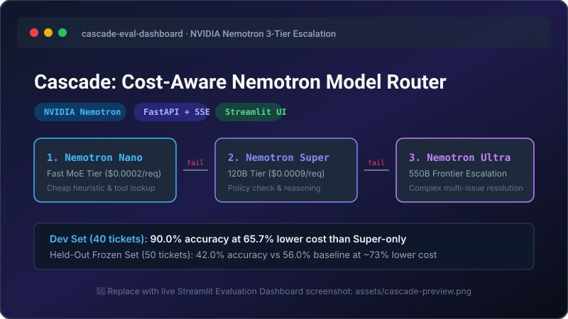
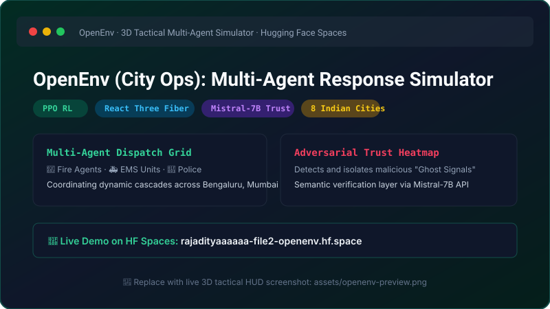
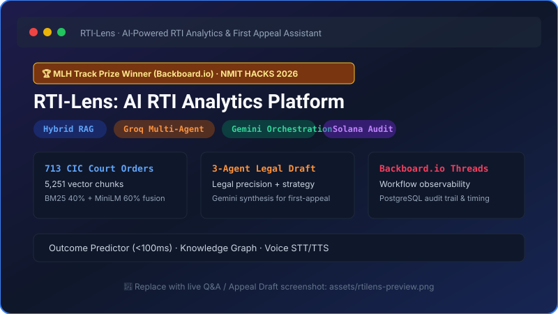
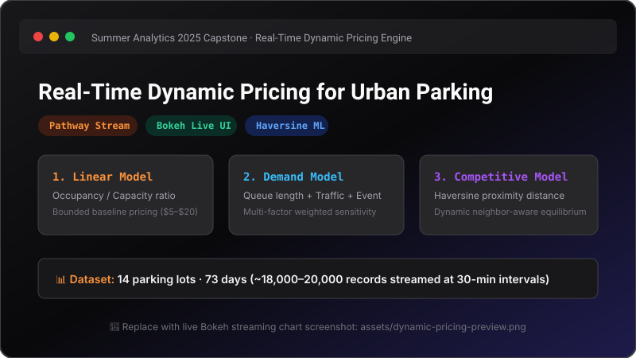
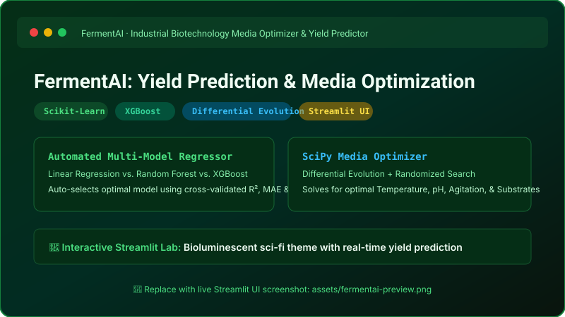

<p align="center">
  
</p>

<p align="center">
  <a href="https://github.com/aditweb13">
    
  </a>
</p>

<p align="center">
  <a href="mailto:adi111sam121@gmail.com"></a>
  <a href="https://linkedin.com/in/aditya-raj-a1891a285" target="_blank"></a>
  <a href="https://leetcode.com/u/adi111sam121/" target="_blank"></a>
  <a href="https://huggingface.co/rajadityaaaaaa" target="_blank"></a>
  
</p>

---

### 👨‍💻 About Me

- 🎓 **Education:** Biotechnology undergraduate (**B.E., Class of 2027**) at **RV College of Engineering**, Bengaluru.
- 💼 **Current Internship:** Data Analyst & Software Developer Intern at **Pushpaka Dashanan**, engineering three data and software portals.
- 🧠 **Applied AI & LLM Systems:** Building production-focused applied AI systems in **LLM model routing & multi-rule verification**, **hybrid RAG pipelines (BM25 + dense embeddings)**, **multi-agent environments**, and **reinforcement learning (PPO)** using Python and FastAPI.
- 📊 **Data Analytics Experience:** Hands-on experience analyzing real-world datasets with **Pandas, NumPy, SQL, Excel, and Power BI** to uncover operational trends and drive data-backed decisions.
- 🎯 **Open To:** **AI/ML Engineer** and **Applied AI** internships and entry-level roles.
- 🔬 **Currently Learning:** Distributed multi-agent orchestration, RLHF, and LLM post-training alignment.
- 💡 **Fun Fact:** Bridging biotechnology wet-lab insights with computational AI — from microbial bioreactor kinetics to multi-agent reinforcement learning!

---

### 🛠️ Tech Stack

<div align="center">

#### Languages
<a href="https://skillicons.dev">
  
</a>

<br/>

#### ML & Data Science
<p>
  
  
  
  
  
  
  
  
  
</p>

#### AI & Large Language Models
<p>
  
  
  
  
  
  
  
</p>

#### Backend & Frameworks
<p>
  
  
  
  
  
  
</p>

#### Databases & Tools
<p>
  
  
  
  
  
  
  
  
</p>

</div>

---

### 📊 GitHub & Coding Stats

<div align="center">
  <table border="0">
    <tr>
      <td align="center" width="50%">
        
      </td>
      <td align="center" width="50%">
        
      </td>
    </tr>
    <tr>
      <td align="center" width="50%">
        
      </td>
      <td align="center" width="50%">
        <a href="https://leetcode.com/u/adi111sam121/" target="_blank">
          
        </a>
      </td>
    </tr>
  </table>
</div>

---

### 🐍 Contribution Activity & Snake

<div align="center">
  <picture>
    <source media="(prefers-color-scheme: dark)" srcset="https://raw.githubusercontent.com/aditweb13/aditweb13/output/github-contribution-grid-snake-dark.svg">
    <source media="(prefers-color-scheme: light)" srcset="https://raw.githubusercontent.com/aditweb13/aditweb13/output/github-contribution-grid-snake.svg">
    
  </picture>
</div>

<p align="center">
  
</p>

---

### 🚀 Featured Projects

<table width="100%">
  <tr>
    <td width="50%" valign="top">
      <h3 align="center">1. Cascade: Cost-Aware Nemotron Router</h3>
      <p align="center">
        <a href="https://github.com/aditweb13/Nvidia">
          
        </a>
      </p>
      <p><b>Description:</b> Cost-aware 3-tier model router for AI agents built on NVIDIA Nemotron. Escalates from Nemotron Nano to Super and Ultra only when verifiers (schema, grounding, policy rules, self-consistency, LLM judge) reject the response.</p>
      <p>
        
        
        
        
        
      </p>
      <p><b>Key Results:</b></p>
      <ul>
        <li><b>Dev Benchmark (40 tickets):</b> <b>90.0% accuracy</b> at <b>65.7% lower cost</b> than Super-only baseline.</li>
        <li><b>Held-Out Test Set (50 tickets):</b> <b>42.0% accuracy</b> vs. 56.0% for single-tier baselines at <b>~73% lower cost</b> than Super-only.</li>
      </ul>
      <p align="center">
        <a href="https://github.com/aditweb13/Nvidia"><b>📂 View Repository</b></a>
      </p>
    </td>
    <td width="50%" valign="top">
      <h3 align="center">2. OpenEnv (City Ops): Multi-Agent Simulator</h3>
      <p align="center">
        <a href="https://github.com/aditweb13/city-opes">
          
        </a>
      </p>
      <p><b>Description:</b> Real-time 3D tactical simulator coordinating EMS, Fire, and Police agents across 8 Indian cities using PPO reinforcement learning under adversarial signal-spoofing attacks.</p>
      <p>
        
        
        
        
        
      </p>
      <p><b>Key Highlights:</b></p>
      <ul>
        <li><b>Adversarial Sabotage Defense:</b> Integrates a spatial trust heatmap backed by Mistral-7B semantic validation to detect and filter fake "ghost signal" dispatches.</li>
        <li><b>Tactical HUD:</b> Full isometric 3D city canvas supporting 8 Indian metropolitan density maps.</li>
      </ul>
      <p align="center">
        <a href="https://github.com/aditweb13/city-opes"><b>📂 View Repository</b></a> · 
        <a href="https://rajadityaaaaaa-file2-openenv.hf.space" target="_blank"><b>🚀 Live Demo</b></a>
      </p>
    </td>
  </tr>
  <tr>
    <td width="50%" valign="top">
      <h3 align="center">3. RTI-Lens: RTI Analytics Platform 🏆</h3>
      <p align="center">
        <a href="https://github.com/anishxagrawal/RTI-Lens">
          
        </a>
      </p>
      <p><b>Description:</b> AI-powered legal analytics platform for India's Right to Information Act. Combines hybrid RAG over 713 Central Information Commission (CIC) court orders with a 3-agent drafting pipeline.</p>
      <p>
        
        
        
        
      </p>
      <p><b>Key Highlights:</b></p>
      <ul>
        <li><b>🏆 MLH Track Prize Winner:</b> Awarded by Backboard.io at NMIT HACKS 2026 for end-to-end AI workflow observability and tracing.</li>
        <li><b>Hybrid Corpus:</b> 5,251 chunks indexed with PageIndex, BM25 (40%), and dense vectors (60%) for case-grounded answers and first-appeal drafting.</li>
      </ul>
      <p align="center">
        <a href="https://github.com/anishxagrawal/RTI-Lens"><b>📂 View Repository</b></a>
      </p>
    </td>
    <td width="50%" valign="top">
      <h3 align="center">4. Dynamic Pricing for Urban Parking</h3>
      <p align="center">
        <a href="https://github.com/aditweb13/Capston-Project">
          
        </a>
      </p>
      <p><b>Description:</b> Streaming dynamic pricing simulation for 14 municipal parking lots over 73 days (~18,000–20,000 records at 30-minute intervals), engineered as the capstone for Summer Analytics 2025.</p>
      <p>
        
        
        
        
      </p>
      <p><b>Key Highlights:</b></p>
      <ul>
        <li><b>3 Pricing Models Benchmarked:</b> Linear baseline, multi-factor demand-based pricing, and Haversine spatial proximity-aware competitive pricing.</li>
        <li><b>Real-Time Pipeline:</b> Ingested continuous time-step data with Pathway streaming UDFs paired with dynamic Bokeh visualizations.</li>
      </ul>
      <p align="center">
        <a href="https://github.com/aditweb13/Capston-Project"><b>📂 View Repository</b></a>
      </p>
    </td>
  </tr>
  <tr>
    <td colspan="2" valign="top">
      <h3 align="center">5. FermentAI: Yield Prediction & Media Optimization</h3>
      <p align="center">
        <a href="https://github.com/aditweb13/microbial">
          
        </a>
      </p>
      <p><b>Description:</b> Machine learning and mathematical optimization platform built for industrial bioprocess engineering. Forecasts microbial fermentation yield and optimizes bioreactor operating parameters.</p>
      <p align="center">
        
        
        
        
        
      </p>
      <p><b>Key Highlights:</b></p>
      <ul>
        <li><b>Automated Model Selection:</b> Trains Linear Regression, Random Forest, and XGBoost regressor pipelines, choosing the top performer across R², MAE, and RMSE metrics.</li>
        <li><b>Dual Optimization Engine:</b> Employs SciPy Differential Evolution and Randomized Search to recommend peak media composition and parameters (temperature, pH, agitation, aeration).</li>
      </ul>
      <p align="center">
        <a href="https://github.com/aditweb13/microbial"><b>📂 View Repository</b></a>
      </p>
    </td>
  </tr>
</table>

<details>
<summary><b>📂 More Projects & Repositories</b></summary>
<br/>

| Repository | Primary Stack | Highlights / Description |
|---|---|---|
| [`aditweb13/commodity-price-forecasting`](https://github.com/aditweb13/commodity-price-forecasting) | Python, Django, FastAPI, Docker | 12-Month Commodity Price Forecasting System (Q1–Q9) with causal monitoring and containerized deployment. |
| [`aditweb13/scaler---hackathon`](https://github.com/aditweb13/scaler---hackathon) | Python, FastAPI, Docker, Pydantic | **Customer Support Triage — OpenEnv:** Reinforcement learning environment training AI agents to classify, route, and resolve enterprise tickets. |
| [`aditweb13/khushi--scalar`](https://github.com/aditweb13/khushi--scalar) | Python, FastAPI, Docker | **SmartRecco-Env:** OpenEnv-compliant RL environment simulating e-commerce product recommendation curation and multi-constraint evaluation. |
| [`aditweb13/prism`](https://github.com/aditweb13/prism) | Python, LightGBM, React, Vite, Claude | **SilentCode:** Proactive clinical deterioration monitoring system on MIMIC-IV vital signs with explainable SHAP analysis. |
| [`aditweb13/Quanta`](https://github.com/aditweb13/Quanta) | C++17, CMake | Crash-safe columnar time-series storage engine for financial market tick and bar data. |
| [`aditweb13/Summer-Analytics-25`](https://github.com/aditweb13/Summer-Analytics-25) | Jupyter, Python, Scikit-learn | Data analytics, exploratory data analysis, and predictive modeling capstone curriculum. |

</details>

---

### ⚡ Recent Activity

<!--START_SECTION:activity-->
<!-- Auto-updated via GitHub Actions .github/workflows/activity.yml -->
- 🚀 Explored and deployed multi-agent reinforcement learning simulations and LLM evaluation harnesses
- 🛠️ Engineering data portals and software pipelines at Pushpaka Dashanan
- 🏆 Awarded MLH Track Prize (Backboard.io) at NMIT HACKS 2026 for RTI-Lens
<!--END_SECTION:activity-->

---

### 💼 Experience & Education

```
  2027 ─── 🎓 B.E. in Biotechnology · RV College of Engineering, Bengaluru (Pursuing)
           │
  Pres ─── 💼 Data Analyst & Software Developer Intern · Pushpaka Dashanan (Ongoing)
           │   • Engineering 3 comprehensive data & software portals
           │
  2026 ─── 💼 Data Analyst Intern · Bold Analytics (Remote, May 2026 – Jul 2026)
           │   • Transformed real-world datasets with Pandas & NumPy
           │   • Identified critical operational anomalies via SQL & Python
           │   • Built interactive Power BI reporting dashboards for business decisions
           │
  2024 ─── 🛡️ Cybersecurity Analyst Virtual Simulation · Tata Group / Forage (May 2024)
               • Threat analysis, incident response, and network ethical hacking
```

---

### 🏆 Achievements & Leadership

- 🥇 **MLH Track Prize Winner (Backboard.io) — NMIT HACKS 2026:** Awarded for production-grade AI workflow observability in RTI-Lens.
- 🎓 **Reliance Foundation Scholar:** Awarded competitive ₹50,000/year merit scholarship; secured **All India Rank 566** among **4.6+ lakh students** in the national selection examination.
- 🤝 **Joint Director, Club Services Avenue — Rotaract Club of RVCE (2025–26):** Spearheaded service initiatives, student mentorship, and organizational logistics.

#### 📜 Certifications
- **Cybersecurity Analyst Job Simulation** — *Tata Group (Forage)*
- **Networking Basics** — *Cisco*
- **AI/ML, Python, & Java Specialization** — *Udemy*
- **Cybersecurity Fundamentals** — *Udemy*
- **Leadership & Sustainability** — *IUCEE NEP*

---

### 📬 Connect With Me

<p align="center">
  <a href="mailto:adi111sam121@gmail.com">
    
  </a>
  <a href="https://linkedin.com/in/aditya-raj-a1891a285" target="_blank">
    
  </a>
  <a href="https://leetcode.com/u/adi111sam121/" target="_blank">
    
  </a>
  <a href="https://huggingface.co/rajadityaaaaaa" target="_blank">
    
  </a>
</p>

---

<p align="center">
  
</p>

<p align="center">
  <i>Thank you for visiting! Feel free to reach out for collaborations or opportunities in AI/ML & Applied AI.</i>
</p>
